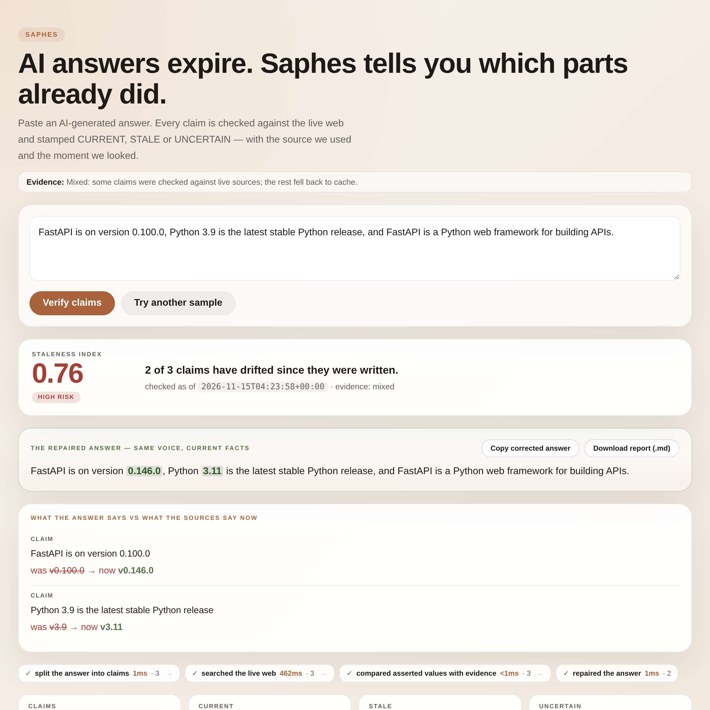

# Saphes

### AI answers expire. Saphes tells you which parts already did.

Paste an AI-generated answer. Saphes splits it into individual claims, checks each claim against
the live web, and stamps it **CURRENT**, **STALE** or **UNCERTAIN** — with the source it used and
the exact moment it looked.



> Built during the Global AI Hackathon (HackCulture), 14–15 November 2026, by team **pheonix**.

---

## Why this is not another fact-checker

A fact-checker asks *"was this ever true?"*. That catches hallucinations.

Saphes asks *"is this still true?"*. That catches **staleness** — and staleness is the failure mode
nobody else is addressing:

| | Hallucination | Staleness |
|---|---|---|
| The claim | was never true | **was true, isn't now** |
| Example | a feature that never shipped | a price that changed in March |
| Why it hurts | obvious once tested | **looks exactly like a correct answer** |
| How you catch it | knowledge | **a check with a date on it** |

A model's training data is frozen at a cut-off. Prices move, API versions get deprecated, regulations
get replaced — and every one of those answers keeps sounding confident. Saphes exists because
*"is this still true"* is a different question that needs a different tool.

## What a run looks like

Real output from this build, 14 Nov 2026:

```
2 of 3 claims have drifted since they were written.
staleness index 0.76 (high risk) · checked as of 2026-11-14T19:12:04+00:00

STALE  FastAPI is on version 0.100.0
       was v0.100.0 → now v0.146.0
       source: fastapi.tiangolo.com/release-notes

STALE  Python 3.9 is the latest stable Python release
       was v3.9 → now v3.11
       source: python.org

CURRENT  FastAPI is a Python web framework for building APIs.
```

### And it repairs the answer

Diagnosis is where other tools stop. Saphes rewrites the answer with the current values, in the
author's own voice:

> FastAPI is on version **0.146.0**, Python **3.11** is the latest stable Python release, and FastAPI
> is a Python web framework for building APIs.

That output is the actual product: **detect → explain → repair → hand over a report.** One click
copies the corrected answer, another downloads a Markdown freshness report you can attach to a PR or
send to whoever owns the docs.

### Four things make that output trustworthy, and all four are deliberate:

1. **Every verdict carries a source URL** fetched during that request — click it, it resolves.
2. **Every verdict carries `checked_at`.** A freshness check without a timestamp contradicts itself.
3. **`uncertain` is a first-class verdict.** When the evidence doesn't state the claim, Saphes says so
   instead of guessing. Both of the answer's remaining claims are decided on evidence, not vibes.
4. **The reasoning is visible.** Every response carries a `trace` with per-step timings — extract,
   search, compare, repair — so nobody has to take a black box on faith.

## How it works

```
answer
  → claim extraction        split into sentences + conjunctions, keep the subject
  → per-claim search query  strip first-person framing, add a category hint
  → live evidence           Tavily search (keyless), 8s timeout, disk cache
  → value comparison        versions compared numerically, prices parsed, dates checked
  → verdict + source + timestamp + staleness index
```

Claims are returned **ordered by risk**, not by position in the paragraph, so the thing that will
embarrass you most is at the top:

```
risk = staleness (stale 1.0 / uncertain 0.5 / current 0.0)
     x volatility (high 1.0 / medium 0.65 / low 0.35)
     x (0.5 + confidence)
```

**Staleness index** is one number per answer, weighted by claim volatility, so a dead price outranks
a dead footnote:

```
index = Σ(volatility_weight × confidence × staleness) / Σ(volatility_weight × confidence)
        staleness: stale = 1.0, uncertain = 0.5, current = 0.0
```

## Run it

```bash
python -m pip install -r requirements.txt
python -m uvicorn app.main:app --host 127.0.0.1 --port 8000 --reload
# then open http://127.0.0.1:8000/   (not the HTML file directly - it needs the API)
```

No API key is required — live search uses Tavily's free keyless mode.

### Demo-day reliability (read this before you record)

Keyless mode is **rate-limited per hour and per day per IP**, and it does return `429` under
repeated use. Saphes is built so that cannot break a demo:

| Situation | What happens |
|---|---|
| Live search works | `evidence_mode: "live"`, sources fetched during the request |
| Keyless allowance exhausted (`429`) | `evidence_mode: "cached"` + `evidence_note` explaining it; real results from `.saphes_cache/` or `app/data/cached_evidence.json` |
| Laptop has no network at all | Same as above, from the bundled recording |
| Nothing cached for that claim | `evidence_mode: "heuristic"`, verdicts from the deterministic rules, clearly labelled |

For an actual recorded run, spend two minutes on a free Tavily key (1,000 credits/month, no card)
and put it in `.env` as `TAVILY_API_KEY` — then `evidence_mode` is `live` on every request and the
hourly cap stops mattering. Keyless is perfect for a first look; a key is better on stage.

### API

```bash
curl -X POST http://localhost:8000/api/verify \
  -H "Content-Type: application/json" \
  -d '{"answer":"FastAPI is on version 0.100.0 and costs $20/month."}'
```

```json
{
  "evidence_mode": "live",
  "checked_at": "2026-11-14T19:12:04+00:00",
  "claims_checked": 2,
  "staleness_index": 0.81,
  "risk_band": "high",
  "headline": "2 of 2 claims have drifted since they were written.",
  "summary": {"current": 0, "stale": 2, "uncertain": 0},
  "corrections": [{"claim": "FastAPI is on version 0.100.0", "asserted": "v0.100.0", "current": "v0.146.0"}],
  "repair": {
    "corrected_answer": "FastAPI is on version 0.146.0 and costs $30/month.",
    "edits": [{"asserted": "v0.100.0", "current": "v0.146.0"}],
    "changed": true
  },
  "trace": [
    {"step": "split the answer into claims", "count": 2, "ms": 1},
    {"step": "searched the live web", "count": 2, "ms": 633},
    {"step": "compared asserted values with evidence", "count": 2, "ms": 0},
    {"step": "repaired the answer", "count": 1, "ms": 1}
  ],
  "results": [ ... per-claim verdict, priority, risk_score, explanation, sources, checked_at ... ]
}
```

## What is live, and what is a seam

Being precise about this matters more than looking complete.

| Capability | Status |
|---|---|
| Live web evidence (Tavily search) | **Real.** Keyless, no signup, real URLs in every response |
| Claim extraction | **Real**, deterministic (sentence + conjunction splitting, subject preserved) |
| Value comparison (versions / prices / percentages) | **Real** |
| Verdicts, confidence, timestamps, staleness index | **Real** |
| Answer repair (corrected text) | **Real** — value-level substitution, style preserved |
| Risk triage + pipeline trace + Markdown report | **Real** |
| Cached evidence fallback | **Real** — `.saphes_cache/` plus a bundled recording in `app/data/` |
| Offline deterministic fallback | **Real, and labelled** — `evidence_mode: "heuristic"` |
| LLM-based claim extraction (`extract_claims_via_bifrost`) | **Seam only.** Returns `None`; the deterministic extractor is what ships |
| Bifrost gateway routing | **Seam only.** Configuring keys does not enable it |

Nothing in a `live` response is synthetic. When the network fails the response says `cached` or
`heuristic` in the payload and in the UI banner — it never dresses up a fallback as live evidence.

## Tests

```bash
pytest        # 30 tests, fully offline (network calls are mocked)
```

Covers: extraction, subject preservation, query building, price drift, price parity, version drift,
release-train isolation, unrelated-evidence uncertainty, cache fallback, rate-limit fallback,
network failure, answer repair (versions, price spellings, no-op), risk ordering, trace shape,
staleness index bounds, API contract, and the served dashboard.

## Project structure

```
app/
├── main.py                     FastAPI app: /, /api/health, /api/verify
├── config.py                   env + timeouts + cache paths
├── models.py                   Claim, ClaimVerdict, EvidenceSource
├── services/
│   ├── claim_extractor.py      answer → claims; claim → search query
│   ├── signals.py              value extraction + version/lexical comparison
│   ├── evidence_service.py     the verdict engine (evidence-based + deterministic fallback)
│   ├── repair.py               rewrites the answer with the current values
│   ├── external_adapters.py    Tavily search (live/cached/bundled) + Bifrost seam
│   └── verifier.py             orchestration, staleness index, risk band
├── data/cached_evidence.json   evidence recorded 14 Nov 2026, for offline demos
└── static/index.html           dashboard: index, timestamp, diff view, sources
tests/                          conftest forces offline mode; adapters tested with mocks
```

## Roadmap

- LLM judge behind the existing `extract_claims_via_bifrost` seam (strict-JSON verdicts, `uncertain` when evidence is thin)
- A "freshness badge" endpoint (`/api/score`) so a docs site can show drift without a human reading it
- Source-date extraction, so drift is shown as "changed around <date>" rather than "changed"
- Claim-level caching keyed on normalised claim text
- A browser extension that warns as you copy an answer

## Honest limitations

- Search quality bounds verdict quality: if the top results don't discuss the claim, the answer is
  `uncertain`, not `current`. That is a deliberate choice.
- Version comparison assumes the evidence page is about the same product; unrelated release trains
  are filtered by major version, which is a heuristic, not a guarantee.
- Private or internal claims can't be verified by a web search, and Saphes says so instead of guessing.
